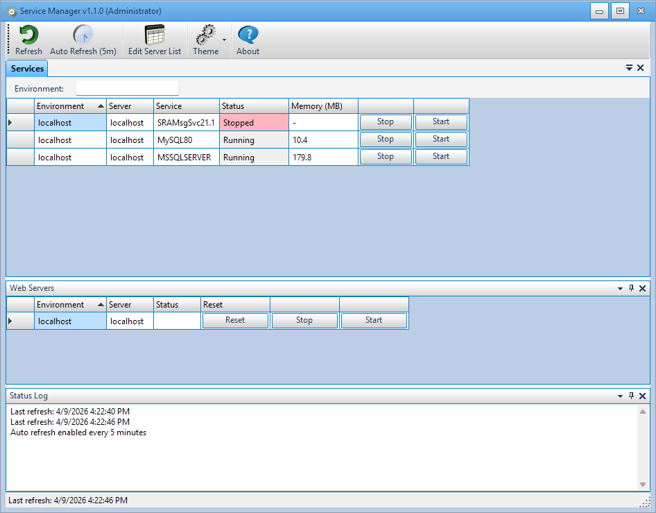

# Service Manager

A Windows desktop application for monitoring and controlling Windows services and IIS web servers across multiple remote machines.

## Features

- **Service Management** - Start, stop, and monitor Windows services on remote servers
- **IIS Management** - Reset, start, and stop IIS on remote web servers
- **Memory Monitoring** - View memory usage (MB) for each running service
- **Auto Refresh** - Configurable automatic refresh interval (default: 5 minutes)
- **Dockable Panels** - Rearrange Services, Web Servers, and Status Log panels with drag-and-drop docking
- **72 Themes** - Choose from 72 community palette themes (Office, Visual Studio, Adobe CC, and more)
- **Environment Filter** - Filter servers by environment name
- **Production Warnings** - Configurable warnings when performing actions on production servers
- **Persistent Settings** - Default sort column, theme, and refresh interval saved to config

## Requirements

- Windows 10/11
- .NET 10 Runtime
- Administrator privileges (for remote service control)
- IIS installed locally (for remote IISReset)

## Getting Started

1. Build and run the application
2. Click **Edit Server List** to add your servers
3. For each server, specify:
   - **Environment** - e.g., DEV, QA, PROD
   - **Server Name** - the machine hostname
   - **Server Type** - Service or WebServer
   - **Service Name** - the Windows service name (for Service type)
4. Click **Refresh** to check service statuses

## Configuration

Settings are stored in `ServiceManager.dll.config`:

| Setting | Default | Description |
|---------|---------|-------------|
| `DefaultSortColumn` | `0` | Column index for default grid sorting |
| `WarnOnProduction` | `true` | Show confirmation dialog for production actions |
| `ProductionEnvironmentTerms` | `prod;production;prd` | Semicolon-separated terms that identify production environments |
| `Theme` | `Asphalt` | Default palette theme name |
| `AutoRefreshMinutes` | `5` | Auto-refresh interval in minutes |

## Themes

The application includes 72 palette themes from the [Krypton-Suite/Theme-Palettes](https://github.com/Krypton-Suite/Theme-Palettes) community repository. Click the **Theme** button to browse and apply themes. Use "Set Current as Default" to persist your choice.

## Third-Party Licenses

### Libraries

| Component | Version | License | Copyright |
|-----------|---------|---------|-----------|
| [Krypton Suite Standard Toolkit](https://github.com/Krypton-Suite/Standard-Toolkit) | 100.26.1.19 | BSD-3-Clause | (c) 2017-2025, Krypton Suite |
| [Newtonsoft.Json](https://github.com/JamesNK/Newtonsoft.Json) | 13.0.3 | MIT | (c) 2007 James Newton-King |
| [System.ServiceProcess.ServiceController](https://github.com/dotnet/runtime) | 9.0.4 | MIT | (c) .NET Foundation and Contributors |
| [System.Management](https://github.com/dotnet/runtime) | 9.0.4 | MIT | (c) .NET Foundation and Contributors |
| [System.Configuration.ConfigurationManager](https://github.com/dotnet/runtime) | 9.0.4 | MIT | (c) .NET Foundation and Contributors |

### Theme Palettes

72 XML palette themes from the [Krypton-Suite/Theme-Palettes](https://github.com/Krypton-Suite/Theme-Palettes) community repository.
- License: BSD-3-Clause
- Copyright (c) 2020, Krypton Suite
- Theme Authors: Krypton-Suite Contributors, Byte#7189 (Adobe CC Dark themes)

### Icons

[Ravenna 3D Icon Set](https://www.softicons.com/toolbar-icons/ravenna-3d-icons-by-double-j-design) by Double-J Design
- License: [Creative Commons Attribution 3.0 Unported (CC BY 3.0)](https://creativecommons.org/licenses/by/3.0/)

## License

This project is licensed under the **MIT License**.

All dependencies use permissive licenses (MIT, BSD-3-Clause, CC BY 3.0) that are compatible with MIT. See the [Third-Party Licenses](#third-party-licenses) section for attribution details.

Copyright (c) 2024 Kevin Adams

Permission is hereby granted, free of charge, to any person obtaining a copy of this software and associated documentation files (the "Software"), to deal in the Software without restriction, including without limitation the rights to use, copy, modify, merge, publish, distribute, sublicense, and/or sell copies of the Software, and to permit persons to whom the Software is furnished to do so, subject to the following conditions:

The above copyright notice and this permission notice shall be included in all copies or substantial portions of the Software.

THE SOFTWARE IS PROVIDED "AS IS", WITHOUT WARRANTY OF ANY KIND, EXPRESS OR IMPLIED, INCLUDING BUT NOT LIMITED TO THE WARRANTIES OF MERCHANTABILITY, FITNESS FOR A PARTICULAR PURPOSE AND NONINFRINGEMENT. IN NO EVENT SHALL THE AUTHORS OR COPYRIGHT HOLDERS BE LIABLE FOR ANY CLAIM, DAMAGES OR OTHER LIABILITY, WHETHER IN AN ACTION OF CONTRACT, TORT OR OTHERWISE, ARISING FROM, OUT OF OR IN CONNECTION WITH THE SOFTWARE OR THE USE OR OTHER DEALINGS IN THE SOFTWARE.

## Author

Kevin Adams - [GitHub](https://github.com/KevinAdams05)
